# Sistema de Gestión de Cine (TAW-251)

API REST desarrollada para el **Sistema de Gestión de Cine** con **NestJS** (modo ESM), **TypeORM** y **PostgreSQL**, con validación de datos mediante DTOs, reglas de negocio en servicios, borrado lógico (`@DeleteDateColumn`), autenticación con **JWT** (`bcrypt`, `JwtAuthGuard`, `addBearerAuth`)[cite: 1] y documentación interactiva en **Scalar** (`/docs`).

---

## Tabla de Contenidos

1. [Arquitectura y Stack Tecnológico](#arquitectura-y-stack-tecnológico)
2. [Entidades y Reglas de Negocio](#entidades-y-reglas-de-negocio)
3. [Autenticación y Seguridad JWT (Extra)](#autenticación-y-seguridad-jwt-extra)
4. [Guía Completa para Clonar, Configurar y Ejecutar el Proyecto](#guía-completa-para-clonar-configurar-y-ejecutar-el-proyecto)
5. [Flujo de Pruebas en Scalar](#flujo-de-pruebas-en-scalar)
6. [Evidencias y Capturas (15 Capturas)](#evidencias-y-capturas-15-capturas)

---

## Arquitectura y Stack Tecnológico

- **Runtime & Lenguaje:** Node.js + TypeScript (ESM)
- **Framework Backend:** NestJS
- **ORM:** TypeORM
- **Base de Datos:** PostgreSQL (`sistema_cine_taw`)
- **Validación:** `class-validator` y `class-transformer` con `ValidationPipe` global
- **Seguridad / Auth:** `bcrypt`, `@nestjs/jwt`, Guard (`JwtAuthGuard`) y `addBearerAuth()` en OpenAPI/Scalar[cite: 1]
- **Documentación Interactiva:** Scalar UI en `http://localhost:3000/docs`

---

## Entidades y Reglas de Negocio

El sistema cuenta con **7 entidades** con borrado lógico (`@DeleteDateColumn`) para conservar la trazabilidad de los datos:

1. **`Salas`:** administración de salas de cine y su capacidad máxima.
2. **`Generos`:** catálogo de géneros cinematográficos.
3. **`Peliculas`:** registro de películas y relación con géneros.
4. **`Clientes`:** registro y consulta de clientes.
5. **`Funciones`:** programación de películas en salas, horarios y precio base.
6. **`Boletos`:** emisión de boletos validando que el número de asiento esté dentro del rango de capacidad de la sala, que no esté repetido dentro de la misma función y asignando automáticamente el precio de la función si no se envía uno explícito.
7. **`Usuario`:** entidad del extra de autenticación con `idUsuario` (PK), `username`, `email` (único), `password` (hasheada con `bcrypt`), `creadoEn`, `actualizadoEn` y `eliminadoEn`[cite: 1].

---

## Autenticación y Seguridad JWT (Extra)

- **`POST /auth/register`:** registra un nuevo usuario guardando su contraseña encriptada con `bcrypt`[cite: 1].
- **`POST /auth/login`:** inicia sesión y devuelve un `access_token` (JWT)[cite: 1].
- **Guard (`JwtAuthGuard`):** protege los endpoints **`POST`**, **`PATCH`** y **`DELETE`** devolviendo **`401 Unauthorized`** si no se envía el token o no es válido; los endpoints **`GET`** permanecen públicos[cite: 1].
- **Scalar (`addBearerAuth`):** permite colocar el `Bearer` token directamente en la interfaz de Scalar para probar las rutas protegidas[cite: 1].

---

## Guía Completa para Clonar, Configurar y Ejecutar el Proyecto

Si otra persona descarga o clona este repositorio, debe seguir estos pasos en orden para hacerlo funcionar exactamente igual:

### Paso 1: Requisitos previos
- Tener instalado **Node.js** (versión LTS recomendada).
- Tener instalado y corriendo **PostgreSQL**.
- *(Opcional)* Tener **pgAdmin 4** o `psql` para inspeccionar las tablas y el borrado lógico.

### Paso 2: Clonar el repositorio e instalar dependencias
```bash
git clone [https://github.com/JOSSEL01/sistema-cine-taw.git](https://github.com/JOSSEL01/sistema-cine-taw.git)
cd sistema-cine-taw
npm install
```

### Paso 3: Crear la base de datos en PostgreSQL
Conéctate a PostgreSQL (desde pgAdmin 4 o `psql`) y crea la base de datos:

```sql
CREATE DATABASE sistema_cine_taw;
```

### Paso 4: Configurar las variables de entorno (`.env`)
El archivo `.env` no se sube al repositorio por seguridad. Crea un archivo llamado `.env` en la raíz del proyecto (junto a `package.json` y `.env.example`) con el siguiente contenido, ajustando los valores a tu entorno local:

```env
PORT=3000
DB_HOST=localhost
DB_PORT=5432
DB_USERNAME=postgres
DB_PASSWORD=tu_password_de_postgres
DB_DATABASE=sistema_cine_taw
JWT_SECRET=clave_secreta_super_segura_taw251
JWT_EXPIRES_IN=1d
```

### Paso 5: Iniciar el servidor
Con PostgreSQL encendido y el `.env` configurado, ejecuta en desarrollo:

```bash
npm run start:dev
```

O para compilar y correr en producción:

```bash
npm run build
npm run start:prod
```

Cuando el servidor inicie sin errores:
- **API:** `http://localhost:3000`
- **Documentación interactiva (Scalar):** `http://localhost:3000/docs`

---

## Flujo de Pruebas en Scalar

1. Abre `http://localhost:3000/docs`.
2. **Sin token:** puedes consultar rutas **`GET`** (`200 OK`), pero si intentas ejecutar **`POST`**, **`PATCH`** o **`DELETE`** en recursos protegidos recibirás **`401 Unauthorized`**[cite: 1].
3. **Registrar y loguear:** ejecuta `POST /auth/register` y luego `POST /auth/login` para obtener el `access_token`[cite: 1].
4. **Autorizar en Scalar:** coloca el `access_token` en la autenticación Bearer (`addBearerAuth`) y repite las peticiones `POST`, `PATCH` o `DELETE` para verificar que ahora responden correctamente[cite: 1].

---

## Evidencias y Capturas (15 Capturas)

### 1. Documentación en Scalar y Operaciones CRUD
- **01 — Módulos en Scalar:**
  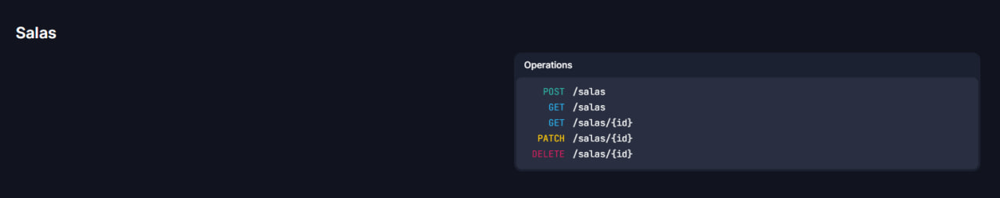
- **02 — Crear sala (`POST` → `201 Created`):**
  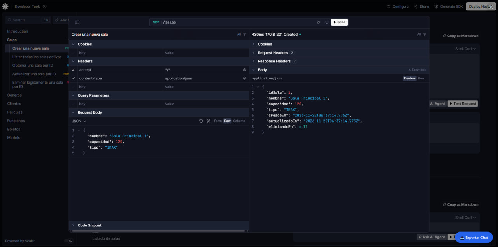
- **03 — Consultar películas (`GET`):**
  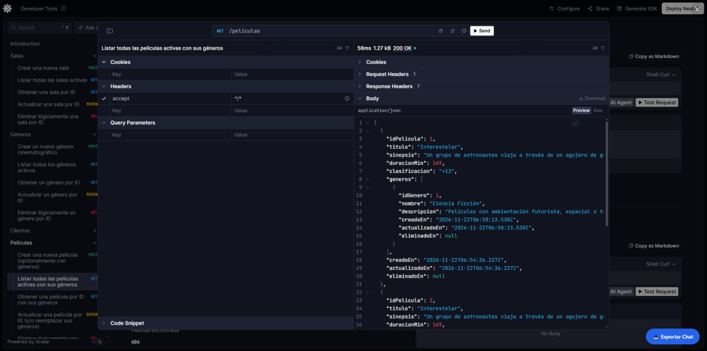
- **04 — Consultar funciones (`GET`):**
  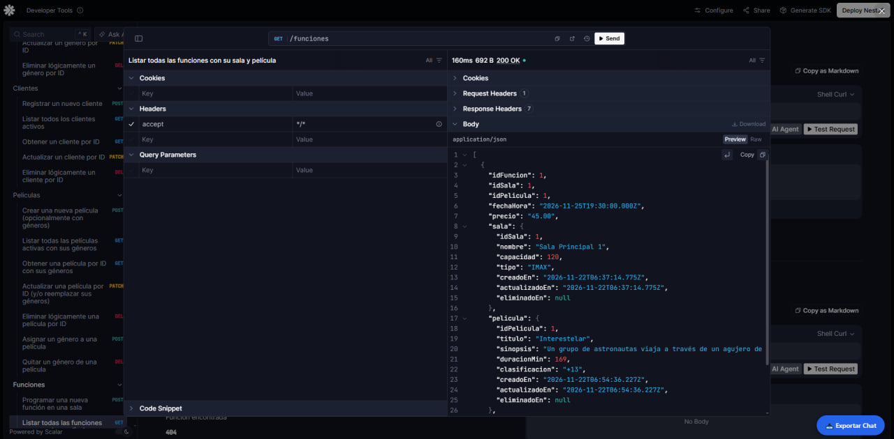
- **05 — Consultar boletos (`GET`):**
  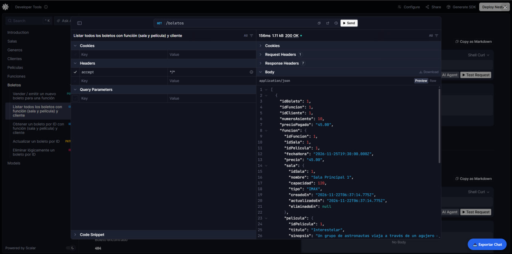
- **06 — Actualizar registro (`PATCH` → `200 OK`):**
  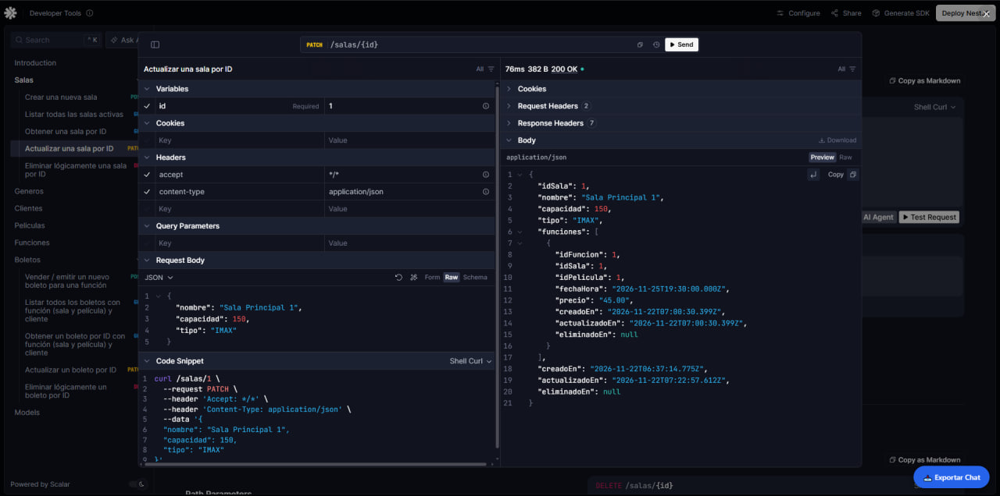
- **07 — Error de validación (`400 Bad Request`):**
  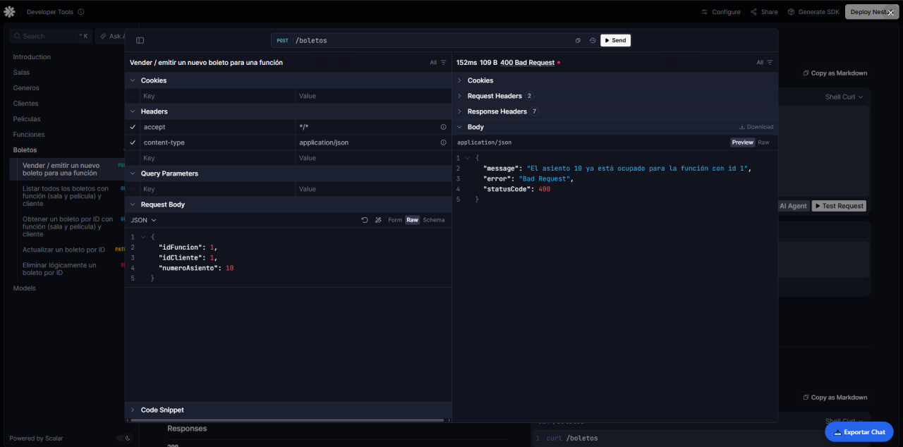
- **08 — Recurso no encontrado (`404 Not Found`):**
  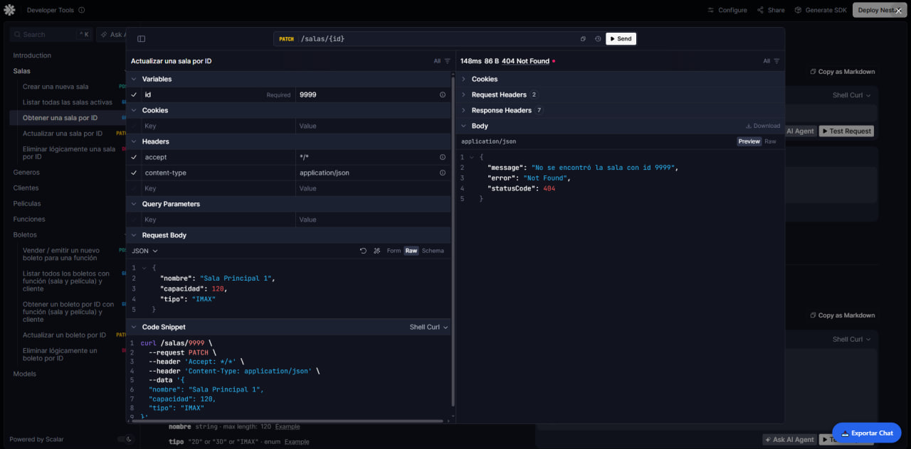
- **09 — Eliminación / Borrado (`DELETE` → `200 OK`):**
  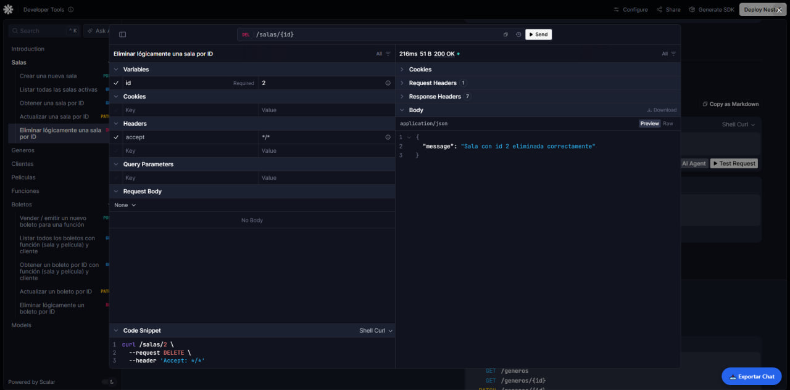

### 2. Base de Datos y Borrado Lógico (pgAdmin 4)
- **10 — Tablas en pgAdmin 4:**
  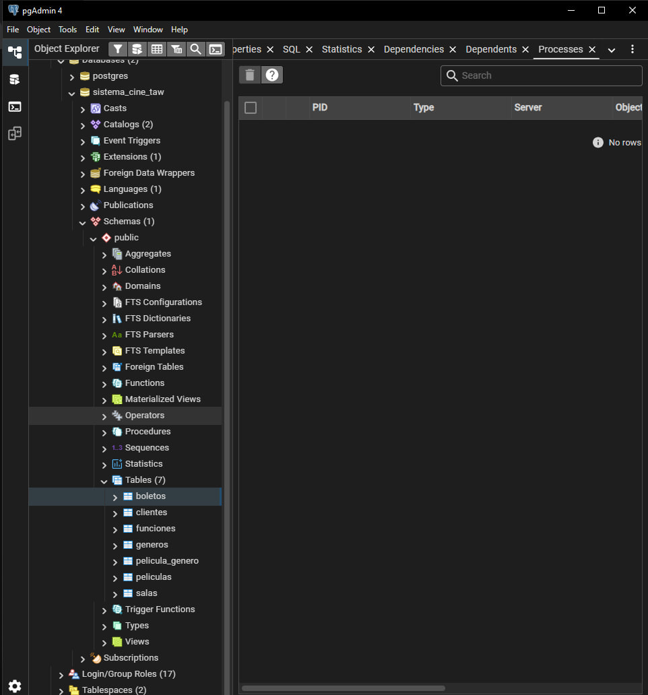
- **11 — Borrado lógico (Soft Delete) en pgAdmin 4:**
  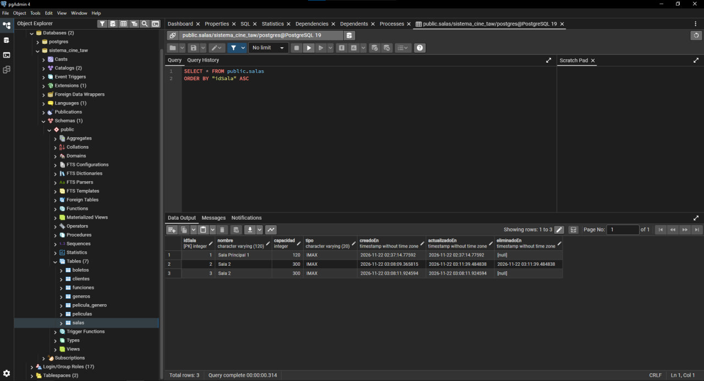

### 3. Extra — Autenticación con JWT
- **12 — Registro de usuario (`POST /auth/register` → `201 Created`):**
  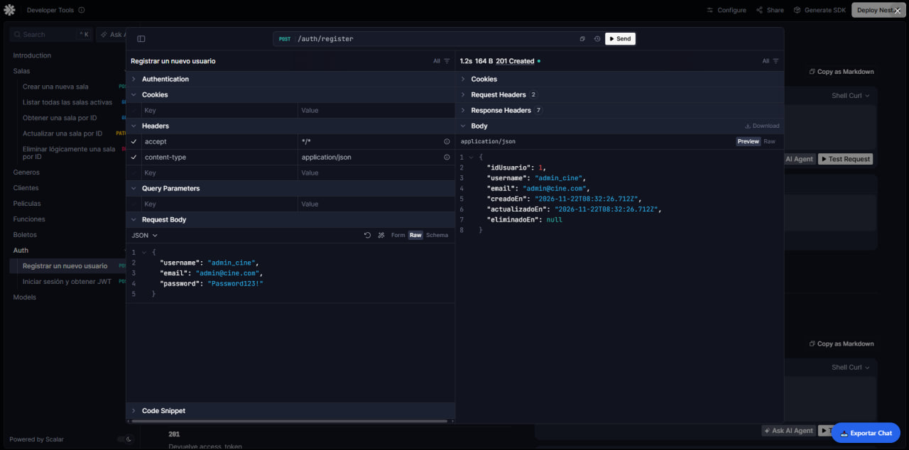
- **13 — Inicio de sesión y obtención de `access_token` (`POST /auth/login`):**
  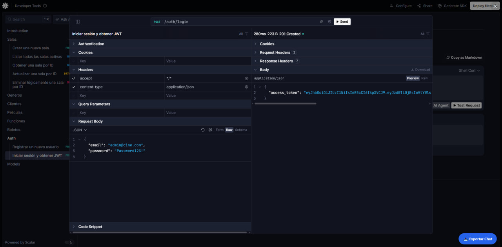
- **14 — Acceso denegado sin token (`401 Unauthorized`):**
  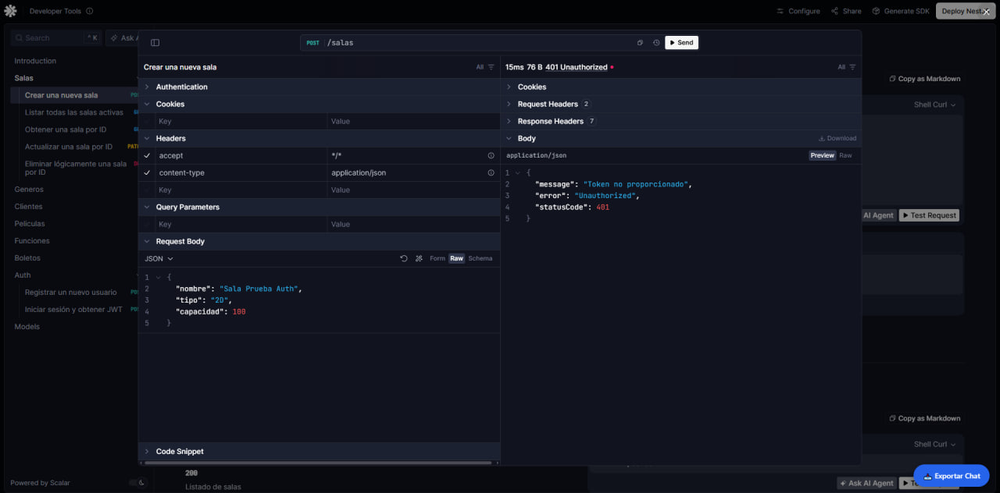
- **15 — Petición protegida exitosa usando `Bearer` token en Scalar:**
  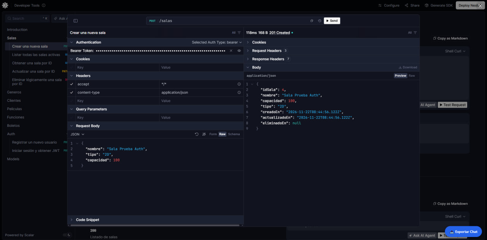
